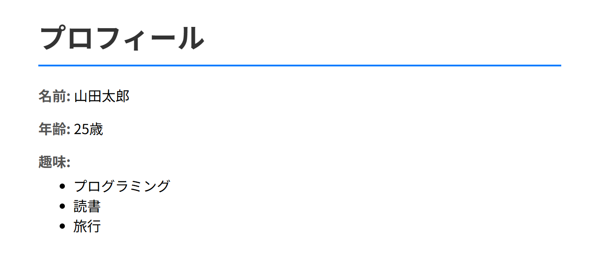

# profile-app-practice

## 概要
COACHTECH 教材 Tutorial 9-1「Laravel基礎ハンズオン」で作成した成果物です。
「`http://localhost/profile`」にアクセスがあった場合に自己紹介ページを表示します。
コントローラー内で設定した固定値がビューに渡され、生成されたHTMLをもとに画面が表示されます。

## 使用技術
- PHP 8.5.12
- Laravel 10.50.3
- Blade テンプレート

## 学んだこと
- LaravelでHTTPリクエストを受け取り、対応するコントローラーのメソッドを実行し、ビューから生成されたHTMLをHTTPレスポンスとして返すという基本フロー
- コントローラー内でビューにデータを渡すための連想配列を定義し、view()ヘルパー関数の第2引数として設定する方法
- Bladeテンプレートで、コントローラから受け取った値を{{ $name }}のように記述して表示する方法

## 動作確認
1. profile-app-practiceディレクトリ上でsail up -dによりyamlファイルに記述した構成通りのコンテナを起動させてネットワークで連携
2. ブラウザで「`http://localhost/profile`」のURLにアクセスして自己紹介ページが表示されることを確認

## 自分のコードと教材のサンプルを比較して学んだこと
- 自分はコントローラー内でビューに渡したい値をそれぞれ変数に格納し、view()関数の第2引数に連想配列を記述していたが、サンプルでは事前に連想配列に渡したい値を格納した後、view()関数の第2引数に連想配列が格納されている変数名を記述していたため、よりコードが見やすかった

## 開発の工夫
- 基本的にルート→コントローラー→ビューの順番で作成することにより、データの流れをイメージしながら作成を進めることができた

## 動作確認のスクリーンショット
「`http://localhost/profile`」にアクセスした時の自己紹介画面
